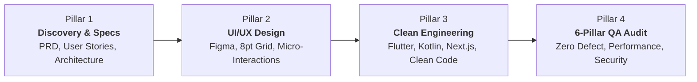

# 📐 MeCod Labs — Official Design System & UI/UX Specification

**Brand Identity:** MeCod Labs (Media & Code Labs)  
**Slogan:** *"Where Media Aesthetics Meet Precision Code"*  
**Visual Style:** Silicon Valley Light Mode • Electric Indigo & Cyber Mint Accents • Crisp Porcelain Canvas  
**Version:** 1.0.0 (Production Master)  
**Author:** MeCod Labs Design Studio (`designer`)  
**Target Audience:** High-ticket international clients (US/EU Startups, Tech Founders, SMBs, Enterprise Product Teams)  

---

## 1. Brand Identity System

### 1.1 Brand Purpose & Core DNA
MeCod Labs bridges the gap between digital creative aesthetics and rigorous software engineering. Unlike traditional agencies that split design and development into disjointed silos, MeCod Labs operates as an integrated product studio. Every project is conceived with pixel-perfect visual balance and implemented with resilient, clean code architecture.

### 1.2 Monogram Logo Design Spec: `<Me/Cod>`
The MeCod Labs brandmark fuses two core disciplines into a single iconic glyph:
1. **The Code Syntax Brackets (`<` and `/>`):** Representing precision engineering, clean syntax, typed structures, and algorithmic execution.
2. **The Media Optical Aperture / Lens Iris:** Integrated into the central slash (`/`) and enclosing negative space, representing camera lenses, color science, 60fps rendering, and visual storytelling.

```
      +-------------------------------------------+
      |               GEOMETRY GRID               |
      |                                           |
      |       <           Me / Cod           />   |
      |   [Angle 75°]   [Optic Blades]   [Angle 75°]
      |                                           |
      +-------------------------------------------+
```

#### SVG Monogram Specification
```xml
<svg width="40" height="40" viewBox="0 0 40 40" fill="none" xmlns="http://www.w3.org/2000/svg">
  <!-- Subtle Gradient Background Container -->
  <rect width="40" height="40" rx="10" fill="#4F46E5" fill-opacity="0.08"/>
  <rect x="0.5" y="0.5" width="39" height="39" rx="9.5" stroke="#4F46E5" stroke-opacity="0.2"/>
  
  <!-- Left Code Bracket "<" -->
  <path d="M14 13L8 20L14 27" stroke="#4F46E5" stroke-width="2.5" stroke-linecap="round" stroke-linejoin="round"/>
  
  <!-- Central Aperture Blade / Division Slash "/" -->
  <path d="M22 11L18 29" stroke="#059669" stroke-width="2.5" stroke-linecap="round"/>
  
  <!-- Media Lens Focal Dot -->
  <circle cx="20" cy="20" r="2.5" fill="#10B981"/>
  
  <!-- Right Code Bracket ">" -->
  <path d="M26 13L32 20L26 27" stroke="#4F46E5" stroke-width="2.5" stroke-linecap="round" stroke-linejoin="round"/>
</svg>
```

#### Brand Lockup (Logo + Wordmark)
- **Monogram Icon:** 36×36px (or 40×40px on desktop header).
- **Wordmark Typography:** Inter Display Bold, 20px, letter-spacing `-0.025em`, color `#0F172A`.
  - **"Me"** in `#0F172A` (Slate 900)
  - **"Cod"** in `#4F46E5` (Electric Indigo)
  - **"Labs"** in `#64748B` (Slate 500, Regular 400 weight)
- **Clear Space:** Minimum exclusion zone equal to the height of the capital letter `M` (24px padding on all sides).
- **Minimum Render Size:**
  - Digital Display: 28×28px (Monogram icon only)
  - Full Lockup: 140px minimum width.

---

## 2. The 60-30-10 Silicon Valley Light Mode Color System

Adhering strictly to the 60-30-10 color discipline creates an uncluttered, high-end, contemporary aesthetic reminiscent of Stripe, Linear, and Apple Developer platforms.

```
  +-------------------------------------------------------------------------+
  |                             COLOR DISTRIBUTION                          |
  |  [====================== 60% =====================][=== 30% ===][= 10% =|
  |                   Canvas / Base                   |  Structural  | Accent  |
  |             Porcelain / Pure White                |  Deep Slate  | Indigo/ |
  |                                                   |  & Borders   |  Mint   |
  +-------------------------------------------------------------------------+
```

### 2.1 Color Breakdown

#### 60% — Dominant Canvas & Surfaces (Clean Porcelain)
- **Page Canvas Base:** `#FAFAFC` (Warm porcelain off-white; eliminates screen glare)
- **Surface Elevation 1 (Card Backing):** `#FFFFFF` (Pure white for floating cards and modal bodies)
- **Surface Elevation 2 (Secondary Cards / Wells):** `#F8FAFC` (Slate 50)
- **Surface Subdued / Code Well:** `#F1F5F9` (Slate 100)

#### 30% — Structural Elements & Content
- **Primary Typography:** `#0F172A` (Slate 900 — high-contrast headlines & titles)
- **Secondary Typography:** `#334155` (Slate 700 — body text, descriptions)
- **Muted / Caption Typography:** `#64748B` (Slate 500 — labels, dates, secondary badges)
- **Hairline Borders & Dividers:** `rgba(15, 23, 42, 0.08)` / `#E2E8F0` (Slate 200)
- **Card Interactive Hover Border:** `rgba(79, 70, 229, 0.30)` (Subtle Indigo tint)
- **Frosted Glass Blur Backdrop:** `rgba(255, 255, 255, 0.82)` with `backdrop-filter: blur(16px)`

#### 10% — Accent & Action Energy
- **Primary CTA Accent (Electric Indigo):** `#4F46E5` (Indigo 600)
  - Hover: `#4338CA` (Indigo 700)
  - Active: `#3730A3` (Indigo 800)
  - Soft Tint Background: `#EEF2FF` (Indigo 50)
- **Live Status & Verification Accent (Cyber Mint):** `#10B981` (Emerald 500)
  - Accessible Text / Badge Variant: `#059669` (Emerald 600)
  - Radar Pulse Glow: `rgba(16, 185, 129, 0.40)`
  - Mint Badge Tint: `#ECFDF5` (Emerald 50)

### 2.2 WCAG 2.1 Accessibility & Contrast Compliance Table

All foreground and background color combinations have been verified against WCAG 2.1 standards for normal and large text.

| Foreground Color | Background Color | Contrast Ratio | WCAG Compliance | Intended Use |
| :--- | :--- | :--- | :--- | :--- |
| `#0F172A` (Slate 900) | `#FFFFFF` (White) | **16.1 : 1** | **AAA (Pass)** | Headings, Primary Titles |
| `#0F172A` (Slate 900) | `#FAFAFC` (Porcelain) | **15.6 : 1** | **AAA (Pass)** | Hero Headline on Canvas |
| `#334155` (Slate 700) | `#FFFFFF` (White) | **9.6 : 1** | **AAA (Pass)** | Standard Body Copy |
| `#64748B` (Slate 500) | `#FFFFFF` (White) | **4.6 : 1** | **AA (Pass)** | Metadata, Subtext, Timestamps |
| `#FFFFFF` (White) | `#4F46E5` (Electric Indigo) | **4.6 : 1** | **AA (Pass)** | Primary Button Text |
| `#FFFFFF` (White) | `#059669` (Cyber Mint Dark) | **4.7 : 1** | **AA (Pass)** | Pill Badges, Status Indicators |
| `#4F46E5` (Electric Indigo) | `#EEF2FF` (Indigo 50) | **5.2 : 1** | **AA (Pass)** | Active Filter Pills, Links |
| `#059669` (Cyber Mint) | `#ECFDF5` (Mint 50) | **5.1 : 1** | **AA (Pass)** | "Available for Contract" Badge |

---

## 3. Typography & 8pt Spatial Grid

### 3.1 Font Stack Hierarchy
- **Primary Interface Font:** `'Inter'`, `-apple-system`, `BlinkMacSystemFont`, `'SF Pro Display'`, `'Segoe UI'`, `sans-serif`
  - Characteristics: Crisp legibility at small sizes, optical tracking, modern neo-grotesque geometry.
- **Code & Telemetry Font:** `'JetBrains Mono'`, `'SF Mono'`, `'Fira Code'`, `monospace`
  - Characteristics: Ligature support, balanced character widths for technical metrics, pill tags, and data badges.

### 3.2 Type Scale System

```
Type Scale Formula: Major Second (1.125) / Minor Third (1.200) tailored for desktop & mobile
```

| Token | Size | Line Height | Weight | Tracking | Target Element |
| :--- | :--- | :--- | :--- | :--- | :--- |
| `text-display` | 48px (3.0rem) | 56px (1.16) | 800 (Extrabold) | `-0.035em` | Hero Primary Headline |
| `text-h1` | 36px (2.25rem) | 44px (1.22) | 700 (Bold) | `-0.025em` | Section Main Titles |
| `text-h2` | 28px (1.75rem) | 36px (1.28) | 700 (Bold) | `-0.020em` | Card Titles, Modal Headers |
| `text-h3` | 20px (1.25rem) | 28px (1.40) | 600 (Semibold) | `-0.015em` | Sub-section & Workflow Titles |
| `text-h4` | 16px (1.0rem) | 24px (1.50) | 600 (Semibold) | `-0.010em` | Small Module Titles |
| `text-body-lg` | 18px (1.125rem)| 28px (1.55) | 400 (Regular) | `-0.005em` | Hero Lead Subtitle |
| `text-body` | 15px (0.9375rem)| 24px (1.60) | 400 (Regular) | `0.000em` | Standard Body Content |
| `text-body-sm` | 13px (0.8125rem)| 20px (1.50) | 400 / 500 | `+0.005em` | Secondary Descriptions |
| `text-mono` | 13px (0.8125rem)| 18px (1.38) | 500 (Medium) | `+0.010em` | Tech Stack Chips, Metrics |
| `text-badge` | 12px (0.75rem) | 16px (1.33) | 600 (Semibold) | `+0.020em` | Status Pills, Micro-tags |

### 3.3 The 8pt Spatial Grid
All margins, paddings, gap dimensions, and component heights align to integer multiples of 8px (with a 4px half-step for micro-adjustments).

- `space-1` = **4px** (Half-step: tag padding, tight borders)
- `space-2` = **8px** (Default gap between text & icons)
- `space-3` = **12px** (Input padding vertical, compact cards)
- `space-4` = **16px** (Standard container padding, button horizontal padding)
- `space-6` = **24px** (Grid gaps, card internal padding)
- `space-8` = **32px** (Section sub-group padding)
- `space-12` = **48px** (Component vertical breathing room)
- `space-16` = **64px** (Major section padding - mobile)
- `space-24` = **96px** (Major section padding - desktop)

### 3.4 Responsive Layout Grid
- **Desktop (>= 1024px):** 12-column grid, max-width `1200px`, 24px gutters, auto margins.
- **Tablet (768px – 1023px):** 8-column grid, max-width `100%`, 20px gutters, 24px screen margin.
- **Mobile (< 768px):** 4-column grid, max-width `100%`, 16px gutters, 16px screen margin.

---

## 4. Layout & Component Architecture

### 4.1 Sticky Frosted Glass Navigation Header
- **Positioning:** Fixed top (`top: 0`, `z-index: 100`).
- **Height:** 72px (Desktop) / 64px (Mobile).
- **Background:** `rgba(255, 255, 255, 0.85)` with `backdrop-filter: blur(16px)` and `-webkit-backdrop-filter: blur(16px)`.
- **Border:** `border-bottom: 1px solid rgba(15, 23, 42, 0.08)`.
- **Navigation Elements:**
  - Left: MeCod Labs SVG Monogram + Wordmark.
  - Center: Nav link pills (`#work`, `#philosophy`, `#stack`, `#team`, `#contact`).
    - Default: `#475569`, 14px font, semibold.
    - Hover: `#0F172A`, background `rgba(15, 23, 42, 0.04)`, `border-radius: 6px`.
    - Active: `#4F46E5`, background `#EEF2FF`.
  - Right: Primary CTA button `[Hire Studio]` (Electric Indigo solid fill, white text, 40px height, 16px padding horizontal).
  - Mobile View: Hamburger toggle button (44×44pt touch boundary), opens a slide-down blur sheet.

### 4.2 Hero Section & Real-Time Availability Radar
- **Layout:** Centered asymmetric container, 96px top padding, 80px bottom padding.
- **Dynamic Live Availability Pill:**
  - Text: `🟢 Available for Q4 2026 Contract Engagements`
  - Styling: Background `#ECFDF5`, border `1px solid rgba(16, 185, 129, 0.3)`, text `#065F46`, font `JetBrains Mono` 12px semibold.
  - Pulsing Radar Dot: 8×8px green dot with a radiating `ping` animation (`box-shadow` or pseudo-element ripple).
- **Headline:**
  - *"We engineer high-performance mobile & web apps with uncompromised media craftsmanship."*
  - Highlighting: "high-performance mobile & web apps" in `#0F172A`, "uncompromised media craftsmanship" with a subtle Electric Indigo gradient (`linear-gradient(135deg, #4F46E5 0%, #06B6D4 100%)`).
- **Subheadline:**
  - *"From Figma design systems and 60fps creative toolkits to native mobile code and production-grade web platforms. Ready for US/EU clients demanding zero-defect engineering."*
- **Action Group (Dual CTAs):**
  - Primary CTA: `[Explore Work ↓]` — Electric Indigo background, white text, 48px height, 24px padding horizontal, `box-shadow: 0 4px 14px rgba(79, 70, 229, 0.3)`.
  - Secondary CTA: `[Book a 15-min Call ↗]` — White background, border `1px solid #CBD5E1`, text `#0F172A`, hover background `#F8FAFC`.
- **Studio Proof Badges:** 3-column micro-metrics bar:
  - `60 FPS` Native Fluid Performance
  - `100%` Typesafe & Automated QA Pass
  - `< 1.2s` Target TTFB & Web Performance

### 4.3 Featured Proof-of-Work Showcase (Case Studies)

#### Card Architecture & Specifications
Each case study card uses a modern elevated card design:
- Surface: `#FFFFFF`
- Border: `1px solid rgba(15, 23, 42, 0.08)`
- Corner Radius: `16px`
- Hover State: `transform: translateY(-4px)`, shadow `0 12px 24px -4px rgba(15, 23, 42, 0.08)`, border `1px solid rgba(79, 70, 229, 0.3)`.

#### The 3 Showcase Projects:
1. **Lumina Lens — AI Creative Studio (Featured Live Interactive Project)**
   - **Tagline:** Next-Gen WebGL/Canvas Image Processor with Film Emulation & K-Means Color Clustering.
   - **Tech Badges:** `HTML5 Canvas 60fps`, `WebGL Shaders`, `K-Means AI`, `Web Workers`, `Vanilla JS`.
   - **Highlight Metrics:** Zero external heavy deps, sub-16ms frame render, real-time histogram generator.
   - **Actions:** `[Launch Interactive Preview]` (Modal Trigger) & `[View Live Demo ↗]`.
2. **PulseFlow — Cross-Platform Mobile Suite**
   - **Tagline:** Realtime Health & Team Workflow Mobile App built for low-latency sync.
   - **Tech Badges:** `Flutter 3.x`, `Native Android Kotlin`, `Supabase Realtime`, `Clean Architecture`.
   - **Highlight Metrics:** 60fps fluid gestures, offline-first caching, 99.9% crash-free sessions.
   - **Actions:** `[Inspect Architecture Blueprint]`.
3. **VividAura — Visual Identity & Product Photography**
   - **Tagline:** Complete Visual Identity, 8pt Figma Design System & App Store Asset Pipeline.
   - **Tech Badges:** `Figma Design Tokens`, `Apple HIG`, `3D Device Mockups`, `Design Ops`.
   - **Highlight Metrics:** 120+ component variants, 4.9/5 client visual rating, +38% conversion uplift.
   - **Actions:** `[View Design Case Study]`.

### 4.4 Interactive Lumina Lens Live Modal Preview Spec
When clicking `[Launch Interactive Preview]` on the Lumina Lens card:
- **Modal Backdrop:** `rgba(15, 23, 42, 0.65)` with `backdrop-filter: blur(8px)`.
- **Modal Container:** Max-width 880px, border-radius 20px, background `#FFFFFF`, border `1px solid rgba(15, 23, 42, 0.12)`, shadow `0 25px 50px -12px rgba(0, 0, 0, 0.25)`.
- **Modal Header:** Project title, live status badge (`🟢 60fps Engine`), and an explicit 44×44pt close button (`✕`) at the top right.
- **Modal Body (Interactive Canvas Simulation):**
  - Left pane: Sample canvas preview (with interactive filter selector: *Kodak Portra 400*, *Fuji Velvia 50*, *Cinematic Mono*, *Bypass Bleach*).
  - Right pane: Real-time telemetry inspector displaying:
    - K-Means dominant color palette swatches (extracted in real time).
    - Render frame latency (`11.4 ms / 60 FPS`).
    - Filter intensity slider (`0% - 100%`).
- **Modal Footer:** Direct external link to live GitHub repo / deployment + `[Close Preview]` button.

### 4.5 Filterable Technology Matrix
The technology stack is organized into 4 logical studio domains with instant client-side filtering:
- **Filter Tabs (Pill Buttons):** `All (16)`, `Mobile Engineering (4)`, `Web Architecture (4)`, `Backend & BaaS (4)`, `Media & Design Systems (4)`.
  - Active Tab: Background `#4F46E5`, Text `#FFFFFF`, font `JetBrains Mono` 13px.
  - Inactive Tab: Background `#F1F5F9`, Text `#475569`, hover background `#E2E8F0`.
- **Card Items Specification:**
  - Icon: 24×24px crisp SVG.
  - Skill Name: 16px Bold `#0F172A`.
  - Level Pill: `Production Ready` / `Mastery` (`#ECFDF5` background, `#059669` text).
  - Context / Experience: 13px `#64748B` detailing where MeCod Labs deploys this technology.

### 4.6 The 4-Pillar Studio Workflow Cards
Structured as a connected sequence representing MeCod Labs' delivery lifecycle:



1. **Pillar 1: Discovery & Architecture Specs:** Functional PRDs, domain boundary maps, ER diagrams, risk matrices.
2. **Pillar 2: UI/UX & Visual Aesthetics:** 8pt spatial grid, 60-30-10 color harmony, fluid animations, Apple HIG & Material 3 adherence.
3. **Pillar 3: Precision Clean Engineering:** Modular state management, strict typing, reactive streaming, sub-second API roundtrips.
4. **Pillar 4: 6-Pillar QA Audit:** Strict pre-delivery verification covering functional workflows, edge cases, responsive viewports, security, clean telemetry, and release handoff.

### 4.7 Team Showcase: The 4 Specialized Roles
Highlights MeCod Labs' agile multidisciplinary team:
1. **Principal Design-Engineer:** Bridges high-fidelity aesthetic design and production code; leads technical architecture and cross-platform UI.
2. **Senior UI/UX & Brand Designer:** Specializes in design systems, micro-interactions, responsive ergonomics, and visual assets.
3. **Senior Full-Stack & Mobile Developer:** Specializes in Flutter, Native Android Kotlin, Next.js, WebGL, and Supabase realtime synchronization.
4. **Lead QA & Reliability Specialist:** Specializes in automated end-to-end testing, responsive audits, accessibility compliance, and release reliability.

### 4.8 Contact, Booking & 1-Tap Copy Email System
- **1-Tap Email Copy Widget:**
  - Displays `mecodlabs@gmail.com` in a monospaced interactive button container.
  - Includes a prominent `Copy Email` icon button (44×44pt touch target).
  - **Interaction Feedback:** On click, writes to clipboard via `navigator.clipboard.writeText()` and triggers a floating toast notification:
    - Text: `✓ Email copied to clipboard (mecodlabs@gmail.com)`
    - Style: Pill banner at bottom center, background `#0F172A`, text `#FFFFFF`, Cyber Mint checkmark icon, 3-second auto-dismiss with fade-in and slide-up animation.
- **Booking & Direct Client Links:**
  - `[Schedule Discovery Call]` (Direct booking integration).
  - `[View Upwork Agency Profile]` (Verified international client channel).
  - Direct inquiry form with validated fields (Name, Email, Project Scope, Budget).

---

## 5. The 4 Mandatory States Specification

Every dynamic component across the portfolio (case study list, tech matrix filter, modal previews, contact form) must implement all 4 states:

```
  +--------------------------------------------------------------------------+
  |                        THE 4 MANDATORY UI STATES                         |
  |                                                                          |
  |  1. EMPTY STATE       2. LOADING STATE    3. ERROR STATE   4. POPULATED  |
  |  [Clean drop/icon]    [Shimmer Skeleton]  [Inline Toast]   [Interactive] |
  |  "No filters match"   "Fetching telemetry" "Failed to load" 60fps Active |
  +--------------------------------------------------------------------------+
```

### 5.1 Empty State
- **Trigger:** When a filter combination returns zero matches or when an interactive input has no content.
- **Visual Design:**
  - Centered porcelain well (`#F8FAFC`), rounded `16px`, dashed border `2px dashed #CBD5E1`.
  - Icon: Neutral slate filter icon (`36×36px`, opacity `0.4`).
  - Title: *"No matching capabilities found"* (`#0F172A`, 16px semibold).
  - Body: *"Try clearing your selected filters to view our full technology catalog."* (`#64748B`, 14px).
  - Action CTA: `[Reset All Filters]` button (Electric Indigo outline, 44pt touch height).

### 5.2 Loading State
- **Trigger:** Async project loading, interactive modal data parsing, or canvas shader compilation.
- **Visual Design:**
  - **No blocking modal spinners.** Use progressive shimmering skeleton cards.
  - Card Skeleton: Animated light gradient sweep:
    ```css
    @keyframes shimmer {
      0% { background-position: -200% 0; }
      100% { background-position: 200% 0; }
    }
    .skeleton {
      background: linear-gradient(90deg, #F1F5F9 25%, #E2E8F0 50%, #F1F5F9 75%);
      background-size: 200% 100%;
      animation: shimmer 1.5s infinite linear;
      border-radius: 8px;
    }
    ```
  - Contextual Status Breadcrumb: *"Compiling WebGL Shader Pipeline... (84%)"*.

### 5.3 Error State
- **Trigger:** Clipboard copy failure, canvas render fallback, or failed form transmission.
- **Visual Design:**
  - Non-blocking alert banner with soft red backing:
    - Background: `#FEF2F2` (Rose 50)
    - Border: `1px solid #FECACA` (Rose 200)
    - Icon: Triangle exclamation in `#DC2626` (Rose 600)
    - Headline: *"Unable to copy to clipboard"*
    - Text: *"Your browser permissions blocked automated copying. Please copy manually: mecodlabs@gmail.com"*
    - Single-Click Recovery Action: `[Retry Action]` or `[Select Email Text]`.

### 5.4 Populated State
- **Trigger:** Normal active state.
- **Visual Design:**
  - Complete card presentation with crisp typography, real-time tags, functional hover effects, and responsive layout adjustments (dual-pane on desktop, stacked card on mobile).

---

## 6. Mobile Ergonomics & Apple HIG Compliance

### 6.1 44×44pt Minimum Touch Target Rule
Following Apple Human Interface Guidelines (HIG) and Android Material Accessibility Standards:
- Every interactive element (navigation links, filter chips, modal close icons, copy buttons, form submit buttons) MUST occupy a minimum bounding box of **44 × 44 pt** (`44px` on standard 1x scale).
- Where visual design calls for a smaller visible chip (e.g., a 28px height filter pill), an invisible pseudo-element `::before` or padding MUST extend the clickable hit target to 44px:
  ```css
  .touch-target-extend {
    position: relative;
  }
  .touch-target-extend::after {
    content: '';
    position: absolute;
    top: 50%;
    left: 50%;
    transform: translate(-50%, -50%);
    min-width: 44px;
    min-height: 44px;
    width: 100%;
    height: 100%;
  }
  ```

### 6.2 Thumb-Reach Zone Architecture (Mobile Viewports)
- **Top Zone (Hard to Reach):** Reserved for brand mark, passive page title, and secondary status indicators.
- **Natural Middle Zone:** Reading content, project showcase cards, tech stack pills.
- **Bottom Zone (Easy One-Handed Reach):**
  - Sticky bottom action bar or floating inquiry trigger.
  - 1-tap copy email toast feedback appears in bottom-center, floating 24px above bottom navigation.
  - Modal sheets slide up from bottom on mobile devices (`border-radius: 20px 20px 0 0`) with a visible swipe drag handle.

---

## 7. Production CSS Variables Design Tokens (`:root`)

The following CSS variables block is ready for immediate inclusion in the production stylesheet (`styles.css`):

```css
:root {
  /* ==========================================================================
     MeCod Labs Design Tokens — Silicon Valley Light Mode
     ========================================================================== */

  /* --- 60% Dominant Canvas & Surfaces --- */
  --bg-canvas: #FAFAFC;
  --bg-surface: #FFFFFF;
  --bg-surface-subtle: #F8FAFC;
  --bg-surface-well: #F1F5F9;
  --bg-card: #FFFFFF;
  --bg-overlay: rgba(15, 23, 42, 0.65);
  --bg-glass: rgba(255, 255, 255, 0.85);

  /* --- 30% Structural & Typography --- */
  --text-primary: #0F172A;     /* Slate 900 - 16.1:1 AAA on White */
  --text-secondary: #334155;   /* Slate 700 - 9.6:1 AAA on White */
  --text-muted: #64748B;       /* Slate 500 - 4.6:1 AA on White */
  --text-inverse: #FFFFFF;     /* Pure White */

  --border-subtle: rgba(15, 23, 42, 0.08); /* Delicate hairline */
  --border-light: #E2E8F0;                  /* Slate 200 */
  --border-focus: #4F46E5;                  /* Electric Indigo */
  --border-hover: rgba(79, 70, 229, 0.35);

  /* --- 10% Brand Accents & CTAs --- */
  --color-primary: #4F46E5;        /* Electric Indigo (Base) */
  --color-primary-hover: #4338CA;  /* Indigo 700 */
  --color-primary-active: #3730A3; /* Indigo 800 */
  --color-primary-light: #EEF2FF;  /* Indigo 50 */
  --color-primary-glow: rgba(79, 70, 229, 0.25);

  --color-accent: #10B981;         /* Cyber Mint (Emerald 500) */
  --color-accent-text: #059669;    /* Accessible Emerald 600 for text */
  --color-accent-light: #ECFDF5;   /* Emerald 50 */
  --color-accent-glow: rgba(16, 185, 129, 0.40);

  /* --- Status & Feedback Tokens --- */
  --color-success-bg: #ECFDF5;
  --color-success-text: #065F46;
  --color-success-border: #A7F3D0;

  --color-danger-bg: #FEF2F2;
  --color-danger-text: #991B1B;
  --color-danger-border: #FECACA;

  --color-warning-bg: #FFFBEB;
  --color-warning-text: #92400E;
  --color-warning-border: #FDE68A;

  /* --- Typography Font Stacks --- */
  --font-sans: 'Inter', -apple-system, BlinkMacSystemFont, 'SF Pro Display', 'Segoe UI', sans-serif;
  --font-mono: 'JetBrains Mono', 'SF Mono', 'Fira Code', monospace;

  /* --- 8pt Spacing Scale Tokens --- */
  --space-0-5: 4px;
  --space-1: 8px;
  --space-1-5: 12px;
  --space-2: 16px;
  --space-3: 24px;
  --space-4: 32px;
  --space-6: 48px;
  --space-8: 64px;
  --space-12: 96px;

  /* --- Border Radius Scale --- */
  --radius-sm: 6px;
  --radius-md: 10px;
  --radius-lg: 16px;
  --radius-xl: 20px;
  --radius-2xl: 28px;
  --radius-pill: 9999px;

  /* --- Elevation & Shadow Tokens --- */
  --shadow-sm: 0 1px 2px 0 rgba(15, 23, 42, 0.05);
  --shadow-md: 0 4px 6px -1px rgba(15, 23, 42, 0.08), 0 2px 4px -2px rgba(15, 23, 42, 0.04);
  --shadow-lg: 0 10px 15px -3px rgba(15, 23, 42, 0.08), 0 4px 6px -4px rgba(15, 23, 42, 0.03);
  --shadow-xl: 0 20px 25px -5px rgba(15, 23, 42, 0.10), 0 8px 10px -6px rgba(15, 23, 42, 0.04);
  --shadow-card-hover: 0 16px 32px -4px rgba(79, 70, 229, 0.12), 0 4px 8px -2px rgba(15, 23, 42, 0.04);
  --shadow-button-primary: 0 4px 14px 0 rgba(79, 70, 229, 0.35);

  /* --- Motion & Transitions --- */
  --transition-fast: 150ms cubic-bezier(0.4, 0, 0.2, 1);
  --transition-normal: 250ms cubic-bezier(0.4, 0, 0.2, 1);
  --transition-bounce: 350ms cubic-bezier(0.34, 1.56, 0.64, 1);

  /* --- Ergonomics & Z-Index --- */
  --min-touch-target: 44px;
  --z-nav: 100;
  --z-toast: 200;
  --z-modal: 300;
}
```

---

## 8. Developer Implementation Checklist & Guidelines

For the development engineer implementing `index.html`, `styles.css`, and `app.js`:

1. **Strict 8pt Grid Enforcement:**
   - Use CSS classes or utility tokens (`padding: var(--space-3); margin-bottom: var(--space-4);`).
2. **Mobile Touch Target Safety:**
   - Add `.min-touch` helper class to all anchor links, icon buttons, filter pills, and form triggers ensuring `min-height: 44px; min-width: 44px;`.
3. **Accessibility Attributes:**
   - All interactive elements must carry descriptive `aria-label` tags (e.g. `aria-label="Copy email mecodlabs@gmail.com"`).
   - Modal preview must trap focus, handle `Escape` key close, and declare `role="dialog"` with `aria-modal="true"`.
4. **Toast Feedback Behavior:**
   - 1-tap email copy button triggers toast with smooth entrance: `opacity: 1; transform: translateY(0);` from `transform: translateY(20px); opacity: 0;`.
   - Auto-hides after 3200ms.
5. **Interactive Filter System:**
   - Filter chips update active states immediately.
   - If filter matches zero results, cleanly transition into the specified **Empty State** with a single-click reset button.
6. **WebGL / Canvas Simulation in Modal:**
   - Provide a live interactive HTML5 Canvas preview allowing users to cycle between color grades and see real-time K-Means palette swatches and 60fps metrics.

---
*Authored by MeCod Labs Designer • Ready for Front-End Engineering Handoff*
